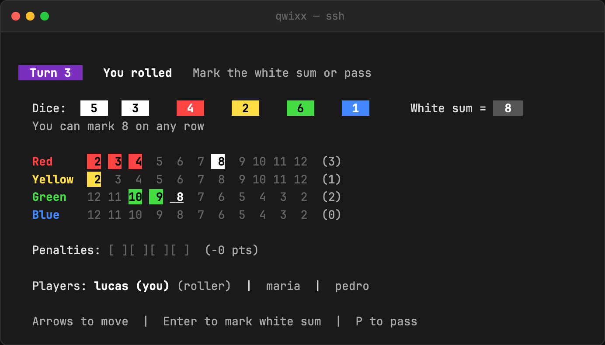

<div align="center">

# 🎲 Qwixx Online

**The Qwixx dice game, multiplayer, entirely in your terminal over SSH. No install, no account.**

```
ssh -p 2222 lucasacastro.cloud
```




[Website](https://qwixx.lucasacastro.com) · [How to play](https://qwixx.lucasacastro.com/how-to-play.html)

</div>

## Features

- **Zero install:** any SSH client is a game client. The whole UI is rendered on the server and streamed to
  your terminal.
- **Real-time multiplayer:** 2–5 players per room. Share a 4-character room code with your friends.
- **The full rules:** white-sum and colored-combo marking, row locking, penalties, end-of-game conditions and
  scoring.
- **Animated dice** and a colored scorecard built with Lip Gloss.

## How it works

```
 your terminal ──ssh──▶ Wish (SSH server) ──▶ one Bubble Tea program per session
                                                 │
                                                 ▼
                                    lobby (rooms, codes, events)
                                                 │
                                                 ▼
                                    game engine (rules, dice, scorecards)
```

The server is built on the [Charm](https://charm.sh) stack: [Wish](https://github.com/charmbracelet/wish)
accepts SSH connections and gives each one its own
[Bubble Tea](https://github.com/charmbracelet/bubbletea) TUI, styled with
[Lip Gloss](https://github.com/charmbracelet/lipgloss). Players in a room share one game engine, and state
changes go out to every connected session.

```
main.go     entry point, CLI flags
server/     SSH server and session management
lobby/      rooms, room codes, player events
game/       engine, rules, dice, scoring (unit + integration tests)
tui/        screens: menu, nickname, waiting room, board, results
docs/       landing page (qwixx.lucasacastro.com)
```

## Development

```bash
go run .                                  # serves on :2222
go run . --host 127.0.0.1 --port 3333     # custom bind address
go test ./... -v -race
```

Then connect with `ssh -p 2222 localhost`.

## Deployment

The game ships as a single Go binary managed by systemd on a VPS.

```bash
ssh me@lucasacastro.cloud 'bash -s' < setup-vps.sh   # one-time: user, dirs, firewall, systemd unit
./deploy.sh me@lucasacastro.cloud                     # cross-compile, upload, restart
```

Every push to `main` runs the tests and, if they pass, deploys automatically via
[GitHub Actions](.github/workflows/deploy.yml).

---

<sub>Qwixx is a trademark of Gamewright / NSV. This is an unofficial fan implementation, made for fun.</sub>
